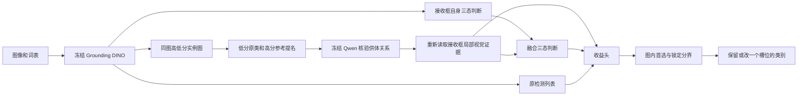

# 项目流程与算法介绍

## 任务与输入输出

系统处理开放词汇检测器已经输出的低分框。给定一张图和当前词表，输入为 Grounding DINO 的 900 个 query 及其框、类别分和视觉表征。实验词表包含 Objects365 的 365 个具体类和 11 个辅助父类提示。改类目标是保住已有正确匹配，同时尽可能通过正确类别补回漏检。

每个候选动作绑定图像、query、原输出槽位、原类和提名类。输出是原生检测列表或修改一个槽位后的列表。框坐标、检测分数和列表次序均沿用原输出，这次实验测量的是分类纠错。即使 AP75 有所变化，其来源仍是类别匹配的变化。

## 一张图怎样产生结果

1. **原生检测。** Grounding DINO 使用 800/1333 图像尺度。具体类别分数达到 0.05 的结果经过类内 NMS，保留最多 100 个槽位。另对有效 query 按类无关 NMS 保留最多 128 个实例图节点。
2. **同图高分参考。** 节点合并 256 维 DINO query 与 512 维裁片 CLIP 表征。DINO 分数、CLIP 类别支持、节点间外观相似度和框重叠共同决定候选供体。低分框的提名类来自供体的具体类别。每个接收节点最多两条具体类边，按提名类组成候选动作。
3. **接收框自身判断。** 按原类、提名类和第三类三种可能打分。结合类别文本、低分框全局特征、五项原生特征和框内 3×3 局部特征。接收端局部视觉只取本次 DINO 前向，来自 stride 16 的 encoder 信息。
4. **逐条关系核验。** 冻结 Qwen 分别读取每条供体边及与之同模板的空参考。可训练关系头区分支持、对比和无效参考。供体通过查询去改变接收框局部特征的读取，`value` 来自接收框视觉特征。作用可能提高、降低或保留提名类的相对分数。
5. **执行判断。** 候选需有真实供体且融合语义唯一支持提名类。收益头接收检测器覆盖证据、冻结风险分、融合语义和实际消息。按收益分选每图首位，达到策略集锁定的分界才改类。混合熵的 JS 在 v2 中只作诊断。

## 三个训练阶段

| 阶段 | 拟合内容 | 核验 |
| --- | --- | --- |
| A 自身分支 | 接收框适配器、文本/读出角色、三态头 | 原类、提名类、第三类；固定后交给 B |
| B 关系与消息 | 供体适配器、关系头、局部查询和消息修正 | 支持、对比、无效参考；有语义证据时监督融合 |
| C 收益分 | 单条候选的 147 维收益 MLP | 是否无损新增匹配；同一动作共享 full/off 标签 |

实验使用 6,038 张训练图、807 张监控图和 871 张策略图。模型、策略和推理输出分别封存。四组比较用同一批独立留出的 2,048 张图，先出预测再评估标注。冻结 v1 的模型与策略单独用于历史对照；v2 置零组用 v2 的权重与同一分界，重新计算语义资格、收益排序和最终动作。

进一步的变量定义和边特征顺序见[算法详情](METHOD.md)。留出集的完整结论见[结果报告](RESULTS.md)。
